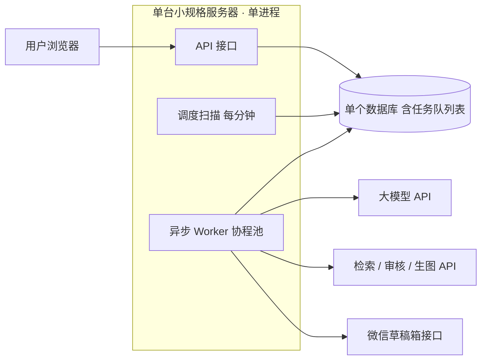

# 项目开发书：公众号自动写稿智能体（暂名「公号智写」）

| 项目 | 内容 |
| --- | --- |
| 文档版本 | V1.13（草案，新增站点页面、法律文本与同意流程） |
| 编制日期 | 2026-10-02 |
| 项目类型 | SaaS 订阅制产品（Web 后台 + 微信公众号对接） |

---

## 1. 项目概述

### 1.1 背景

公众号运营者普遍面临"持续选题难、写作耗时长、更新不稳定"的问题。大模型具备成熟的文本生成能力，结合微信公众平台的草稿箱接口，可以做到"设定方向 → 自动成稿 → 自动入草稿箱"，由运营者在草稿箱审阅后一键发布。

### 1.2 项目目标

- 用户注册后只需**设定写作方向和推送周期**，系统即可定期自动生成文章并推送到其公众号草稿箱。
- 建立「免费 / 普通 / 高级」三档会员体系，另提供买断版，实现稳定的订阅收入。
- 首期（MVP）上线 3 个月内完成核心链路闭环，稳定运行。

### 1.3 项目范围

- **范围内**：用户系统、公众号授权绑定、写作方向配置、定时生成、草稿箱推送、认证号自动发布、表格与图片生成、会员与支付、运营后台；认证号数据分析与运营优化（P2）。
- **范围外**：自动群发（群发接口）、小程序端、视频号 / 小红书等多平台分发、对他人文章图片的自动抓取。

> 说明：个人账号无法认证、没有发布接口，企业未认证号同理，由系统推草稿，用户在手机「公众号助手」审阅并手动发布；仅企业主体且已认证的公众号可自动发布（见 8.7 节）。

---

## 2. 目标用户

| 用户类型 | 痛点 | 核心诉求 |
| --- | --- | --- |
| 个人自媒体 / 副业博主 | 没时间写、没灵感 | 低成本保持日更/周更 |
| 小微企业运营 | 缺少专职编辑 | 稳定产出行业内容 |
| 工作室 / 代运营 | 账号多、产量大 | 多账号批量管理 |

---

## 3. 功能需求

### 3.1 用户端

1. **注册登录**：手机号 / 微信扫码登录。
2. **公众号绑定**：授权绑定公众号，选择主体类型（个人 / 企业）与认证状态，展示绑定状态与权限检测结果。
3. **写作方向设定**（核心）：支持「全托管模式」——只指定方向（如“母婴”），选题、栏目、风格由系统规划，见 7.7 节；也支持精细设置：
   - 领域与主题关键词（如"职场成长""母婴育儿"）
   - 目标读者、语言风格（从风格库选择）、排版模板与主题色、篇幅（800 / 1500 / 3000 字）
   - 禁用词与避讳话题、固定开头结尾（如关注引导）
4. **推送周期设置**：每日 / 每周几；选择时段而非精确时间；每个公众号每日最多 1 批，按账号类型给出推荐周期（见 6.2、8.3 节）。
5. **文章管理**：生成记录、状态（生成中 / 已入草稿 / 失败）、预览、重新生成、失败原因提示。
6. **通知**：文章入草稿箱后站内信 / 微信服务通知提醒。
7. **会员中心**：当前等级、额度用量、申请开通与续费（管理员手工开通）、订单记录。
8. **手动干预**（P1）：立即生成、指定题目、暂停 / 恢复、否决选题（见 8.3 节）。
9. **邀请推广**：生成专属邀请链接，查看邀请数与奖励额度（见 4.2 节）。
10. **账号与隐私**：查看同意记录、管理授权（可撤回）、账号注销、个人数据导出（见 3.5 节）。

### 3.2 智能体核心能力

| 模块 | 说明 |
| --- | --- |
| 选题规划 | 依据写作方向生成子方向树与月度内容日历，按栏目与时间节点选题，主题级去重（见 7.7 节） |
| 资料检索 | 联网检索素材（高级版），保证时效与事实依据 |
| 文章生成 | 按所选语言风格、栏目结构与篇幅生成标题、摘要、正文（结构化输出，不直接生成 HTML） |
| 内容审核 | 敏感词、违规内容、事实可疑点检测、参考来源校验，不通过则重写 |
| 排版 | 将结构化正文按所选排版模板渲染为内联样式的公众号 HTML（见 7.13 节），文末生成「参考来源」区块 |
| 配图 | 封面图与正文配图（图库或 AI 生图，注意版权） |
| 推送 | 上传素材并写入草稿箱，失败自动重试 |
| 质量闭环 | 收集用户评分，并回读草稿箱中本系统创建的草稿，对比原稿判断是否被修改、删除；按采用率与修改率迭代提示词版本，做 A/B 对比 |

### 3.3 运营后台

用户与订单管理、**套餐与额度配置**（价格、每日 / 每月额度、功能开关、各类调用上限）、**服务配置中心**（文本模型、生图、联网搜索、热点源、审核、支付、通知，见 5.9 节）、买断与定制套餐授权、权益调整、邀请奖励配置与风控审核、垂类规则包管理、风格库与排版模板管理、页面与法律文本管理（版本化）、同意记录查询、侵权投诉处理、成本看板与熔断阈值、内容审核与举报处理、任务监控与告警、操作审计日志、数据看板（注册、转化、续费、单篇成本）。

### 3.4 功能优先级

| 级别 | 内容 |
| --- | --- |
| P0 MVP 必做 | 注册登录、公众号绑定与权限检测、写作方向与周期、定时生成、草稿推送（或降级导出）、基础审核、额度控制、免费版、全托管模式基础版（只选方向，系统自动选题）、基础风格选择与基础排版模板（7.13 节）、注册同意流程与协议页、公众号绑定教程（3.5 节） |
| P1 收费版 | 支付与订阅、套餐升降级、反馈采集、草稿回读与修改检测、失败通知、运营后台基础功能、垂类规则包（管理员可配置，多垂类）、内容日历、风险分级、认证号自动发布（8.7 节）、表格与图片生成（7.9 节）、完整风格库与排版模板库、站内预览（7.13 节）、宣传页与定价页、帮助中心、账号注销与数据导出、投诉入口（3.5 节） |
| P2 增强 | 联网检索、个人风格学习（含用户修改差异学习）、事实核查与原创度检测、多账号管理、第三方平台授权、认证号数据分析与运营优化（7.11 节）、数据图表、授权引用图片（7.10 节） |

### 3.5 站点页面与法律文本

**3.5.1 页面清单**

| 类别 | 页面 | 说明 |
| --- | --- | --- |
| 对外宣传（无需登录） | 首页（落地页）、功能介绍、定价与会员对比、示例文章展示、邀请推广落地页、帮助中心 / FAQ、关于我们与联系方式 | 价格与额度从套餐配置读取，自动与后台一致；做成静态页面，由内置 Web 服务提供 |
| 注册与登录 | 注册页、登录页、找回账号 / 换绑手机 | 见 3.5.2 |
| 法律文本 | 用户协议、隐私政策、免责声明、会员与退款规则（含买断条款）、邀请活动规则、内容与发布规范（红线） | 后台版本化管理，注册与关键操作处引用 |
| 使用引导 | 公众号绑定教程、授权说明页、新手引导 | 绑定教程图文分步：获取 AppID / AppSecret、添加 IP 白名单、开启草稿箱、在手机「公众号助手」审阅并发布；授权说明页写明权限范围与内容责任确认 |
| 服务入口 | 投诉举报、侵权投诉（通知—删除）、联系客服、账号注销、个人数据导出 | 投诉受理后须核查、处理并回复，时限后台可配 |

**3.5.2 注册与同意流程**

- **注册**：手机号验证码 → 用户**主动勾选**「已阅读并同意《用户协议》《隐私政策》」（不得默认勾选）→ 创建账号。每次同意写入 consent_log（条款类型与版本、时间、IP、设备）。
- **单独同意**：下列事项在对应场景单独勾选，可随时撤回并留痕：绑定公众号凭证（授权说明页）、读取用户其他草稿标题（7.x、6.3 节）、数据分析授权（认证号）、开启自动发布（内容责任确认）、设备信息用于邀请防刷、修改差异用于风格学习。
- **条款更新**：重大变更须重新弹窗同意，未同意不得继续使用核心功能；旧版本可查。
- **注销与导出**：用户可在站内申请注销并删除数据（公众号凭证立即删除，文章与日志按隐私政策保留期清理），并可导出个人数据。
- **适用人群**：协议约定仅限成年人使用，注册页声明。

**3.5.3 隐私政策应覆盖的内容（供法务撰写）**

- 收集的信息与目的：手机号、账号信息、公众号 AppID 与授权凭证、写作方向与设置、生成的文章与草稿回读内容、范文（风格学习）、订单与额度、设备与 IP（安全与防刷）、日志。
- 最小必要，以及上述单独同意事项。
- 委托处理与第三方：模型、生图、搜索服务商会处理用户内容；微信平台；短信与邮件服务商。若所选服务商在境外，须额外告知并取得单独同意。
- 存储地点与期限：文章正文保留 30 天、凭证解绑即删、日志保留期、备份。
- 安全措施：凭证加密、最小权限、审计日志。
- 用户权利：查阅、复制、更正、删除、撤回同意、注销、导出；响应时限、申诉与联系方式。
- 未成年人、政策更新方式。

**3.5.4 用户协议与免责声明应覆盖的要点（供法务撰写）**

- **服务说明与审阅义务**：内容由 AI 生成，可能存在错误；个人号、未认证号用户须审阅后手动发布；认证号用户开启自动发布的，确认并承担发布内容责任。
- **责任划分**：发布内容的责任归用户；平台不保证阅读量、涨粉、收益或「爆款」；内容不构成医疗、法律、投资等专业建议（与文章文末的免责声明一致）。
- **第三方依赖**：微信接口、模型服务可能变更或中断；因微信规则调整、公众号被限制或封禁、接口权限回收造成的损失，在法律允许范围内平台不承担责任。
- **用户义务**：不得生成违法违规或侵权内容，不得邀请作弊，不得转售账号或额度；用户须有权授权其公众号。
- **知识产权**：生成内容的权利归属与使用、用户上传范文与图片的授权声明。
- **付费条款**：价格与开通方式（管理员手工开通）、到期与降级、退款规则、买断「终身」＝服务存续期间，以及服务终止时的处理（通知期、数据导出、是否退还部分费用）；额度规则；邀请奖励规则与撤销。
- **其他**：服务变更、暂停与终止，违规处理，争议解决与适用法律。

**3.5.5 宣传与广告页面的合规要求**

- 不作绝对化或保证性表述：不承诺「爆款」「10w+」「涨粉」「收益」，不用「最」「第一」「唯一」等绝对化用语。示例文章须标明是示例，引用的数据须可核实。
- 价格与规则必须真实一致，限制条件同处明示：如「免费每月 10 篇，邀请最多 30 篇」「买断即终身（服务存续期间），每年最多 365 篇」。
- 不展示未实现或未实测的功能（如认证号自动发布实测前标注「即将上线」）。
- 不擅自使用第三方公众号、品牌标识或用户案例，使用须取得书面同意；做竞品对比只陈述可核实的事实，并注明时间与来源。
- 邀请推广页须展示奖励规则与限制，不得虚假诱导。
- 境内服务器公开对外访问前须完成 ICP 备案（已延后），备案完成前宣传页仅用于内测。

---

## 4. 会员体系（已确认方案，价格与额度后台可调）

> **收款方式**：首期不接入在线支付。用户付款后由管理员手工收单，在后台开通会员（与买断、定制授权同一入口），订单由管理员登记；在线支付作为后续可选组件，服务配置中心已预留。

| 权益 | 免费版 | 普通版 | 高级版 | 买断版 |
| --- | --- | --- | --- | --- |
| 价格 | 0 元 | 月付 30 元 / 年付 299 元 | 月付 99 元 / 年付 990 元 | 一次性 3000 元（终身版），管理员后台授权 |
| 每天篇数 | 1 篇 | 1 篇 | 最多 5 篇（按用户合计，分配到各公众号） | 同高级版 |
| 额度上限 | 每月 10 篇（邀请推广最多 30 篇） | 每月 30 篇 | 每月最多 150 篇（按用户合计） | 每年最多 365 篇（按用户合计） |
| 发布方式 | 个人号、企业未认证号：推草稿，手动发布；企业认证号：自动发布（各档位相同） | 同左 | 同左 | 同左 |
| 生成时效 | 夜间低峰批量，次日清晨前入草稿 | 指定时段内 | 指定时段内，优先处理 | 同高级版 |
| 可绑定公众号 | 1 个 | 1 个 | 5 个 | 5 个 |
| 写作方向数量（建议） | 1 个 | 3 个 | 不限 | 不限 |
| 单篇字数上限（建议） | 1000 字 | 2000 字 | 4000 字 | 4000 字 |
| 模型路由 | 基础模型 | 标准模型 | 高级模型 | 同高级版 |
| 联网检索 / 热点选题 | ✗ | 基础 | ✓ | ✓ |
| 参考来源标注 | 强制 | 强制 | 强制 | 强制 |
| 认证号运营数据分析 | ✗ | 基础周报 | 完整报告 + 自动调整选题权重 | 同高级版 |
| 配图 | 图库封面 | 封面 + 配图 | 图库配图 + AI 生图（张数上限后台可配） | 同高级版 |
| 个人风格学习（上传范文） | ✗ | ✗ | ✓ | ✓ |
| 语言风格选择（建议） | 3 种基础风格 | 全部预设风格 | 预设风格 + 自定义风格（范文学习） | 同高级版 |
| 排版模板（建议） | 2–3 套基础模板 | 全部内置模板 + 预设色板 | 全部模板 + 自定义主题色与品牌元素 | 同高级版 |
| 事实核查与原创度检测 | ✗ | 基础 | ✓ | ✓ |
| 文末"AI 辅助创作"标识 | 运营方暂不添加 | 同左 | 同左 | 同左 |
| 客服 | 社区 | 在线 | 优先 | 优先 |

注：高级版与买断版「每天最多 5 篇」按用户账号合计，由用户分配到各公众号：绑定 1 个公众号可用 5 篇，绑定 5 个公众号则合计仍为 5 篇（如每个 1 篇）；月 / 年额度同样按用户合计。买断版额度按授权日起的每个周年重置（建议）。 注：运营方当前决定暂不办理生成式 AI 服务登记、暂不添加 AI 内容标识；系统保留「标识开关」，可在后台随时开启，风险见第 10 节。

**规则**

- 价格、额度、功能开关均在管理员后台「套餐配置」中设置，上线后可随时调整。
- 年付约等于 10 个月价格（普通 299 元、高级 990 元）。
- 免费版按自然月重置额度，付费版按购买周期；降级在当前周期结束后生效。
- 买断版由管理员在后台授权，不走在线支付；授权与撤销写入审计日志。
- 多号运营者：管理员可在后台创建定制套餐（价格线下洽谈，额度与公众号数量自定义），不走在线支付。

### 4.1 单篇成本与毛利测算（假设值，须用实际模型单价和 100 篇样本均值校准）

| 档位 | 单篇成本假设 | 月额度 | 满额月成本 | 月收入 | 毛利率（额度用满） |
| --- | --- | --- | --- | --- | --- |
| 免费 | 约 0.15 元（基础模型 + 批量 + 图库） | 10（推广最多 30） | 1.5 元（最多 4.5 元） | 0 | — |
| 普通 | 约 0.3–0.6 元 | 30 | 9–18 元 | 30 元（年付折合约 24.9 元） | 月付约 40%–70%；年付约 28%–64% |
| 高级 | 约 1.0–2.5 元（高级模型 + 检索 + AI 生图） | 150 | 150–375 元 | 99 元（年付折合 82.5 元） | **月付约 −52% 至 −279%；年付约 −82% 至 −355%（亏损）** |
| 买断 | 同高级 | 365 篇 / 年 | 365–912.5 元 / 年，持续发生 | 3000 元一次性 | 满额使用下，3000 元可覆盖约 3.3–8.2 年成本 |

- **盈亏平衡**：普通版满额使用的盈亏平衡单篇成本约 1.0 元（月付）；高级版约 0.66 元（月付）、约 0.55 元（年付折合），按上表假设满额使用会亏损。买断版「终身」没有结束日期而成本逐年发生：按假设成本满额使用，约 3.3–8.2 年后开始亏损；单篇成本控制在 0.5 元时可覆盖约 16 年。实际使用率须上线后统计。
- 每 100 个免费用户满额使用的月成本约 150 元（推广满额约 450 元），需要约 7–13 个普通付费用户的毛利覆盖，即转化率约 7%–13%，高于此前 5% 的目标，须重新评估。
- **建议对策（价格由你决定，以下为可选项）**：① 管理员为高级版路由低成本模型，并在后台限制每篇的 AI 生图张数、联网检索次数、模型调用次数；② 设置用户月成本熔断线，达到阈值后降级模型或暂停高成本功能；③ 买断版把「终身」定义为服务存续期间（须法务确认），并保持每年 365 篇的上限；④ 上线后用真实单篇成本和使用率回测，再决定是否调整价格与额度。
- 服务器固定成本另计（1 台 2 核 4G 加数据库备份），不含人力与推广。

### 4.2 邀请推广奖励（免费用户）

**奖励规则（已确认）**：免费用户通过专属邀请链接推广，每个「有效邀请」奖励 +2 篇 / 月，累计上限 +20 篇（免费额度最多 30 篇 / 月）。付费用户不享受邀请奖励；用户升级付费后奖励不再计入额度，邀请关系保留，降回免费版则恢复（建议）。参数在后台可调。

**有效邀请的定义**（须全部满足，奖励才生效）：

1. 被邀请人是新用户，通过邀请链接注册；邀请关系只在注册时建立一次，事后不可补填或修改。
2. 手机号验证通过，且未被风控识别为虚拟号 / 接码号。
3. 绑定了一个公众号并通过绑定检测（草稿读写成功），且该公众号此前从未被任何账号绑定过。
4. 成功生成并推送至少 3 篇草稿。
5. 注册后经过 7 天观察期，期间账号未被封禁、公众号未解绑；观察期结束后奖励才生效。

**防滥用措施**

| 手法 | 对策 |
| --- | --- |
| 自己邀请自己、批量小号互刷 | 同手机号、同设备指纹、同公众号、同登录 IP 段短时间集中注册的，不计入；公众号全平台唯一绑定（同一公众号同一时间只能被一个账号绑定，解绑后 30 天内不能被其他账号绑定），小号必须各自拥有真实公众号 |
| 接码平台、虚拟号 | 屏蔽常见虚拟运营商号段，接入风控评分，评分高的号码不计入奖励 |
| 注册后立刻弃用，或领完奖励就解绑 | 3 篇草稿门槛 + 7 天观察期；被邀请人解绑、被封禁或判定作弊，撤销对应奖励（已生成的文章不追回，后续额度相应扣减） |
| 短时间集中拉人 | 每个邀请人每天最多计入 3 个有效邀请；短期数量异常自动冻结奖励，进入后台人工审核队列 |
| 脚本批量注册 | 同 IP、同设备每日注册次数限制；注册验证码；邀请链接访问与注册速率监控 |
| 互惠群、违规渠道推广 | 用户协议明确禁止作弊与垃圾推广，违规者奖励清零、账号封禁 |

- **成本封顶**：每个邀请人的额外成本有上限（按假设单篇成本 0.15 元，最多约 3 元 / 月），刷满也不会无限放大；真正的屏障是「手机号 + 全平台唯一公众号 + 观察期」，批量作弊的成本远高于所得。
- **运营监控**：后台看板跟踪邀请转化率、有效邀请 7 日留存、同设备 / IP 聚集度、解绑率；超过阈值自动冻结并通知管理员。

---

## 5. 系统设计

### 5.1 设计原则：最小资源占用

核心判断：文本、图片的生成都由外部 API 完成，自有服务器只负责「调度 + 网络转发 + 存取数据」，属于 **I/O 密集而非计算密集**，因此可以用很小的资源运行。

| 原则 | 做法 |
| --- | --- |
| 不自建模型 | 不配 GPU、不部署本地模型；写作、检索、审核、生图均调用外部 API |
| 单体优先 | 模块化单体，API、调度、Worker 在同一进程内，不拆微服务 |
| 少中间件 | 首期只用一个数据库；不引入 Redis、消息队列，用数据库任务表做队列 |
| 异步 I/O | 使用协程，等待模型返回时不占线程，单进程可同时跑数十个任务 |
| 削峰填谷 | 不在整点集中触发；任务在时段窗口内打散执行，并按会员等级排优先级 |
| 静态前端 | 纯静态页面，由镜像内置 Web 服务提供（可选接 CDN），不做服务端渲染 |
| 不落地大文件 | 图片流式转发给微信，不长期保存；服务器只存文本数据 |
| 能批量就批量 | 免费版、普通版在低峰期使用大模型批量接口（通常更便宜） |

### 5.2 总体架构

### 5.3 技术选型（精简版）

| 层 | 方案 | 说明 |
| --- | --- | --- |
| 前端 | Vue3 / React，打包为纯静态文件，响应式 Web（不做小程序） | 由镜像内置 Web 服务提供，可选接 CDN |
| 后端 | Python FastAPI（asyncio）或 Go，单进程 | Go 内存占用更低；团队熟悉 Python 则选 FastAPI |
| 调度 | 每分钟一次扫描「下次执行时间 ≤ 当前时间」的计划 | 不为每个用户建定时器，一次索引查询即可 |
| 任务队列 | 数据库任务表 + 行锁领取（SKIP LOCKED） | 首期不引入 Redis / MQ |
| 数据库 | 1 个 MySQL / PostgreSQL（小规格或托管版） | 只存文本；图片不入库，素材由微信侧保存 |
| 缓存 | 进程内内存（access_token、套餐配置） | 暂不需要 Redis |
| 内容审核 | 本地敏感词匹配（AC 自动机，内存占用很小）+ 管理员可配置的外部审核接口（可选） | 不运行本地审核模型 |
| 图片 | 图库 / 生图接口由管理员配置；内置轻量图片压缩（libvips 或 Pillow） | 压缩后上传微信图片接口，不长期落地 |
| 部署 | OCI 镜像（Docker），compose 一键部署，首期 1 台 2 核 4G，**需固定公网出口 IP** | 微信接口需 IP 白名单；详见 5.10 节 |
| 监控 | 内置健康检查接口，日志输出到 stdout，失败任务告警 | 可接入任意监控系统，不自建监控 |

### 5.4 调度与削峰策略

- 用户选择**时段**（如"早上 8 点前入草稿箱"）而非精确到分钟，系统在窗口内为任务随机分配执行时间。
- 优先级：高级 > 普通 > 免费；免费版安排在夜间低峰，可走批量接口。
- 并发控制：全局并发上限（如 20）、单用户同时 1 个任务；模型接口限流时自动退避重试。
- 容错：任务状态全部入库，进程重启后将超时的运行中任务重新入队；以「计划 ID + 日期」为幂等键，防止重复生成或重复写入草稿。

### 5.5 核心流程（单次定时任务）

1. 调度扫描发现到期计划 → 校验会员状态与额度 → 写入任务表（幂等键），按等级设置优先级与执行时间。
2. Worker 领取任务 → 读取写作方向 → 选题并去重。
3. 按档位执行内容流水线（见第 7 节）：免费版一次调用产出标题、摘要、正文，普通、高级版分阶段生成。
4. 审核：先本地规则过滤并校验参考来源（引用登记、网址可访问），必要时再调用云端审核；未通过则带原因重写，最多 2 次，仍失败则标记失败且不扣额度。
5. 按所选排版模板渲染（模板字符串拼接，无需渲染引擎；模型只输出结构化正文），生成表格与文末参考来源区块，按提示词配图并经微信图片接口转存（见 7.9 节），转换为公众号 HTML，并校验正文长度与体积上限（见 7.13 节）。
6. 上传封面素材，调用草稿箱新增接口，记录 media_id；认证号按设置在审阅窗口后提交发布并跟踪结果（见 8.7 节）。
7. 扣减额度、通知用户、清理临时数据。

### 5.6 降低模型调用成本（同时降低服务器压力）

- 选题与审核用小模型，正文按会员档位路由到对应模型。
- 固定提示词部分启用提示词缓存；一次生成多个选题供后续多篇使用。
- 联网检索结果按主题缓存 24 小时，相同方向的用户共享。
- 正文只保留 30 天，到期清理；草稿已在微信侧，无需长期留存。

### 5.7 资源估算与演进路线（估算值，需压测验证）

**估算**：单篇任务约 90 秒，其中 90% 以上在等待外部 API；并发上限 20，调度窗口 6 小时，则单台 2 核 4G 每天可处理约 4,800 篇（20 × 6 × 3600 ÷ 90）；20 个协程的内存约百 MB 级。

| 阶段 | 规模（日更活跃用户） | 部署方式 |
| --- | --- | --- |
| 1 起步 | ≤ 3,000 | 1 台 2 核 4G，单进程；数据库同机或小规格托管 |
| 2 增长 | 3,000–20,000 | 数据库独立；Worker 拆成可多实例的独立进程，引入 Redis 做队列 |
| 3 规模化 | > 20,000 | API 与 Worker 分离，Worker 以多副本容器运行（compose 或 K8s），出口统一经固定 IP 出口 |

代码层面将「队列」抽象成接口，升级时只替换实现，不改业务逻辑。

### 5.8 核心数据表

| 表 | 关键字段 |
| --- | --- |
| user | 用户 ID、手机号、会员等级、到期时间 |
| wx_account | 用户 ID、AppID、授权信息（加密）、账号类型、交付模式（自动 / 手动导出）、绑定状态 |
| writing_plan | 用户 ID、公众号 ID、方向、模式（精细 / 全托管）、风格预设、风格调节参数、排版模板、主题色、篇幅、周期、状态 |
| article_task | 计划 ID、触发时间、状态、失败原因、耗时、消耗 token |
| article | 任务 ID、标题、备选标题、摘要、正文、来源清单、封面、草稿 media_id、提示词版本、排版模板与版本、风险等级 |
| article_source | 文章 ID、序号、类型（新闻 / 政策 / 标准 / 数据）、来源名称、标题、发文机关与文号或标准号、发布日期、原始网址、展示网址（「.」替换为「点」）、可访问性校验结果 |
| quota_usage | 用户 ID、周期、已用 / 总额度 |
| order | 订单号、套餐、金额、支付状态、有效期、支付回调幂等号 |
| quota_ledger | 用户 ID、变动类型（发放 / 扣减 / 退回）、数量、关联任务（额度流水，便于对账） |
| content_calendar | 计划 ID、月份、日期、栏目、子方向、主题、状态 |
| topic_coverage | 计划 ID、子方向、主题标签、生成时间（主题级去重） |
| vertical_pack | 垂类、子方向树、栏目模板、红线、来源白名单、配图规范、版本 |
| style_preset | 名称、描述、语气 / 人称 / 句式 / 用词 / 结构特征、禁忌、示例段、适用垂类、适用档位、启用状态 |
| layout_template | 名称、分类、区块与样式配置、主题色选项、适用垂类、适用档位、版本、实测状态、启用状态 |
| legal_doc | 类型（用户协议 / 隐私政策 / 免责声明 / 退款与买断规则 / 邀请规则 / 内容规范）、版本、内容、生效日期、状态 |
| consent_log | 用户 ID、条款类型与版本、授权项、时间、IP、设备、是否撤回 |
| site_page | 页面标识（首页 / 定价 / 帮助 / 绑定教程等）、内容、版本、状态 |
| complaint | 类型（内容举报 / 侵权投诉 / 其他）、提交人、内容、状态、处理记录、回复时间 |
| publish_job | 文章 ID、模式（仅草稿 / 自动发布）、计划发布时间、publish_id、状态、失败原因 |
| image_asset | 文章 ID、位置、类型（封面 / 配图 / 引用图）、来源（AI 生图 / 图库 / 用户素材 / 授权引用）、图片提示词、微信图片 URL、授权声明、来源标注 |
| mp_stats | 公众号 ID、日期、文章 ID、阅读、分享、收藏、新增关注等指标 |
| ops_report | 公众号 ID、周期、诊断结论、建议、系统已做的调整、采纳状态 |
| service_config | 类型（文本 / 生图 / 联网搜索 / 热点源 / 审核 / 支付 / 通知）、协议、接口地址、密钥（加密）、模型名、参数、单价、优先级、档位路由、启用状态 |
| plan_config | 套餐、价格、每日 / 每月额度、功能开关、各类调用上限 |
| referral | 邀请人、被邀请人、状态（待观察 / 有效 / 已撤销）、观察期截止时间、设备指纹、风控评分、奖励额度、生效月份 |
| entitlement | 用户 ID、来源（购买 / 买断授权 / 定制授权 / 活动）、档位、有效期、操作管理员、备注 |
| feedback | 文章 ID、用户反馈（已发布 / 修改后发布 / 弃用）、评分、草稿回读结果（是否修改、修改幅度、是否被删除） |
| prompt_version | 版本号、提示词内容、启用档位、A/B 分组 |
| audit_log | 凭证访问、授权变更、后台操作记录 |

### 5.9 服务配置中心与模型网关

用户完全不接触 API Key，全部由管理员在后台配置。

| 项目 | 说明 |
| --- | --- |
| 服务类型 | 文本模型、生图、联网搜索、热点源（含 MCP）、内容审核（可选）、支付（可选）、短信 / 邮件通知（可选） |
| 通用配置 | 名称、协议（OpenAI 兼容 / 自定义 HTTP 模板）、接口地址、密钥、模型名、参数、超时与重试、单价、限流、优先级、启用状态 |
| 自定义接口 | 支持配置请求模板与响应字段映射，接入非标准服务 |
| 档位路由 | 每个档位 × 每个环节（选题、大纲、正文、标题打分、自检、生图提示词等）可指定不同服务 |
| 故障转移 | 主服务失败或限流时自动切换备用服务 |
| 连接测试 | 保存前可一键测试连通性 |
| 密钥安全 | 加密存储，后台掩码显示，日志脱敏，变更写审计日志 |
| 成本核算 | 按单价与实际 token、张数、调用次数统计到每篇文章与每个用户，驱动成本看板与熔断 |
| 内部抽象 | 业务代码只依赖 chat、image、search、hot_topics 四类统一接口，不依赖具体供应商 |

部署方须自行确保所选服务合法合规（如大模型备案）。

### 5.10 镜像部署（可部署到任意服务器）

- **交付物**：OCI 镜像（Docker），由自己运营，不设许可证机制。应用镜像含后端、Worker 与内置静态前端；compose 文件同时编排数据库；支持 amd64 与 arm64。
- **一键部署**：docker compose。配置通过环境变量与后台完成：数据库连接、主密钥（用于加密 API Key 与公众号凭证）、域名；数据持久化到挂载卷。
- **不绑定云厂商**：对象存储、内容审核、图片处理、密钥管理、支付、通知均为可配置或可选组件，默认使用镜像内置实现（本地文件存储、本地敏感词、内置图片压缩、应用主密钥信封加密）。
- **运行要求**：服务器须有固定公网出口 IP（用于微信 IP 白名单），能访问外部模型服务与微信接口；对外入口通过反向代理提供 HTTPS。
- **运维**：健康检查接口；日志输出到 stdout；数据库迁移随版本自动执行；提供数据库与配置的备份、恢复命令；升级即替换镜像。

---

## 6. 微信对接要点与可行性前提

> **前提**：核心链路依赖公众号草稿接口。个人未认证订阅号可写入并读取草稿（用户实测确认），因此个人号、未认证号均可自动推送草稿（发布由用户手动完成）。微信规则可能调整，开发第 1 周仍须用真实账号做回归验证，并保留降级方案。

### 6.1 已核实的事实（来自微信官方文档）

- 2025 年 7 月起，个人主体账号、企业主体未认证账号及不支持认证的账号，被回收「发布能力」相关接口（发布草稿、发布状态查询、已发布列表等）的调用权限。**因此个人号、未认证号只能推草稿，由用户在手机公众号助手发布；已认证号可调用发布接口自动发布。**
- 草稿箱接口（新增、更新、列表、详情、总数、删除、草稿箱开关设置）在官方文档中有列出，但页面没有逐一写明各主体类型的调用权限。**个人未认证订阅号可写入草稿并读取草稿内容（用户实测确认）**；未认证企业号预期相同，待回归验证。

### 6.2 账号类型与发布方式

**已确认**：本项目支持个人（未认证，订阅号 / 服务号）与企业两类主体。个人账号无法认证，没有发布接口权限，不支持自动发布；仅企业主体且已认证的公众号支持自动发布。草稿读写已由用户实测可用（个人未认证订阅号）。官方规则：订阅号每天可群发 1 条，服务号每月可群发 4 条；2025 年 7 月起个人主体、企业未认证及不支持认证的账号失去发布能力接口。企业用户发布接口每天最多调用 100 次（微信规定）。本产品不调用群发接口。

| 主体 | 认证状态 | 发布接口 | 产品处理 |
| --- | --- | --- | --- |
| 个人（订阅号 / 服务号） | 无法认证 | 无权限 | 推草稿，用户在手机「公众号助手」审阅并手动发布；授权用 AppID / AppSecret |
| 企业 | 未认证 | 无权限 | 同上 |
| 企业 | 已认证 | 可用 | 推草稿并按用户设置自动发布（8.7 节）；授权可优先第三方平台扫码，或用 AppID / AppSecret |

- **绑定检测**：用户绑定时选择主体类型与认证状态；系统依次验证 access_token、素材上传、草稿写入与读取、草稿箱开关；选择「企业已认证」时，再用只读的「获取已发布的消息列表」接口探测发布权限，返回无权限则按手动发布处理。
- **绑定唯一性**：同一公众号同一时间只能被一个账号绑定；解绑后 30 天内不能被其他账号绑定，防止换号重复领取免费额度与邀请奖励。
- **手动发布提醒**：提醒消息中附公众号助手入口，并提示订阅号每天 1 次群发、服务号每月 4 次的限制；高级版同日多篇建议在公众号助手合并为多图文。
- **降级方案（手动导出）**：仅在检测不通过时启用（如微信调整规则、草稿箱关闭）：文章保存在站内，提供「一键复制排版 HTML」，用户粘贴到公众号编辑器，并站内 + 邮件提醒。粘贴效果须实测。
- **风险**：主要是微信规则变动，须持续监控接口返回并保留降级方案。

### 6.3 授权与安全

- MVP：用户填写 AppID / AppSecret，并把我方固定出口 IP 加入白名单（门槛较高，流失会偏大）；正式版接入开放平台第三方平台扫码授权（需相应资质与审核，须提前申请）。
- 凭证加密存储（密钥与数据库分离，信封加密，主密钥由部署方通过环境变量或挂载文件提供），日志不记录明文；用户可随时解绑，解绑即删除凭证。
- 最小权限：个人号、未认证号只使用素材与草稿相关接口；认证号仅在用户开启「自动发布」后调用发布接口，数据统计接口仅在用户同意后调用；不调用群发接口，不调用删除已发布文章的接口。读取草稿默认仅限本系统创建的草稿（按 media_id）；读取用户其他草稿的标题用于选题去重，须用户在授权页明确同意。

### 6.4 异常处理与通知

| 情形 | 处理 |
| --- | --- |
| access_token 失效、授权被取消、AppSecret 被重置 | 暂停该公众号任务，通知用户重新授权，不扣额度 |
| 草稿箱开关关闭或草稿箱已满（以官方限制为准） | 推送前查询开关与总数；提示用户处理，恢复后自动继续 |
| 接口限频、超时 | 退避重试，以幂等键防止重复写入 |
| 微信内容检查不通过 | 记录失败原因，重写 1 次，仍失败则通知用户 |

通知渠道：站内信 + 邮件为必选；可选绑定自有服务号推送模板消息。

---

## 7. 内容策略：用大模型写标题与正文

> 没有任何方法能保证「爆款」。目标是**稳定产出高于平均水平的文章**，并用用户反馈数据持续迭代；效果须经第 12 节的样本评审与 A/B 验证。

### 7.1 分阶段流水线，而不是一次出稿

| 阶段 | 做法 | 模型 |
| --- | --- | --- |
| ① 选题 | 候选来自用户方向、常青选题池、热点（见 7.12 节）、历史高采用主题；按相关度、读者关注度、差异化、可写性、风险打分，取最高；全托管模式下以内容日历当期条目为准（见 7.7 节） | 小模型 |
| ② 角度与大纲 | 为选题生成 3 种切入角度（反常识、场景故事、清单干货、避坑对比等），选 1 个；输出大纲：开头钩子、3–5 个论点、案例、结尾行动引导 | 档位模型 |
| ②′ 资料检索与来源登记 | 普通基础检索、高级完整检索：获取新闻、政策、标准等资料并登记来源（类型、名称、标题、发布日期、网址）；正文只能使用已登记的资料 | 检索 API + 小模型摘要 |
| ③ 标题 | 一次生成 15–20 个候选，覆盖数字清单、悬念、对比、痛点、利益点、提问等模板；先过规则（长度、违禁词），再按评分表打分，最高分作标题，其余存为「备选标题」供用户在站内替换 | 小模型 |
| ④ 正文 | 按大纲分节生成并设字数预算；前 100 字用场景、问题或数据切入；段落短、小标题密，适度用列表与金句 | 档位模型 |
| ④′ 表格与配图 | 标注需要表格与图片的位置，生成表格 HTML 与图片提示词，调用生图 / 图库接口（见 7.9 节） | 小模型 + 外部 API |
| ⑤ 自检改写 | 按清单检查事实风险、重复度、AI 套话、风格一致性、合规，不通过则定向重写 | 小模型 + 规则 |
| ⑥ 来源标注 | 在引用处加角标序号，文末生成「参考来源」区块；校验引用与登记一致、网址可访问（详见 7.6） | 规则 |

### 7.2 标题规则

- 推荐 15–25 字；评分维度：好奇心缺口、具体性（数字、对象）、与读者相关、情绪强度、可信度。
- **红线**：不夸大承诺、不制造恐慌、不诱导分享、不用「震惊」「不转不是…」类标题党词；审核时核对标题的承诺是否被正文兑现。具体以微信公众平台运营规范为准。

### 7.3 内容质量控制

| 问题 | 措施 |
| --- | --- |
| 编造事实 | 提示词硬性规定：无来源不写具体数据、人名、引语；凡引用新闻、政策、标准等外部资料，必须在文末标注参考来源（见 7.6 节），供用户核对 |
| 千篇一律、AI 腔 | 维护套话禁用表（如「综上所述」「在当今社会」）；要求句长变化；注入用户风格画像；标题与结构模板轮换 |
| 风格不一致 | 高级版：用户上传 3–5 篇范文，提取「风格画像」（语气、句式、常用词、结构、禁忌）存库，写作时注入提示词；不做模型微调，无训练成本 |
| 敏感领域 | 医疗、投资理财、时政、法律咨询类方向默认拦截，或强化审核并加免责声明；母婴等含健康养育内容的垂类，通过垂类规则包（7.8 节）放行并强化约束 |
| 版权 | 不抓取、不仿写特定他人文章；检索素材仅作事实参考，改写后附来源 |

### 7.4 各档位的内容流水线

| 档位 | 流程 | 模型调用次数（约） |
| --- | --- | --- |
| 免费 | 一次调用产出标题候选、摘要、正文；标题仅规则过滤；不联网，因此**不得写具体政策、标准、新闻事件与数据** | 1–2 |
| 普通 | ① 选题 → ② 大纲 → ②′ 基础检索（按需）→ ④ 正文 → ③ 标题打分 → ⑤ 规则自检 → ⑥ 来源标注 | 3–5 |
| 高级 | 全流程 + 完整联网检索 + 风格画像 + 来源与事实核验 + 二次润色 | 5–7 |

调用次数直接决定 4.1 节的单篇成本，上线前须按实际调用次数重算。各档位使用的具体模型、检索与生图服务由管理员在后台路由配置。

### 7.5 评测与迭代

- 上线前：人工评审 100 篇样本，按 1–5 分评：标题吸引力、结构、事实准确、可读性、AI 腔、合规。
- 上线后：采集用户反馈采用率、修改率、评分；按 prompt_version 做 A/B（按用户分组，每次只改一个变量），每两周迭代一次。
- 「爆款经验库」来自平台内聚合数据（标题模板 × 选题类型 × 采用率），不依赖抓取他人文章。阅读量等数据能否通过接口获取以账号权限为准，获取不到时只用采用率，或由用户手动填写。

### 7.6 引用与来源标注规范

**硬性规则**：只要正文使用了来自外部网址的新闻、政策、标准、统计数据或他人观点，**文末必须注明引用来源**；无来源的具体政策、标准、新闻事件和数据一律不得写入。用户在写作方向中提供的参考链接，同样须登记并标注。

| 项目 | 规范 |
| --- | --- |
| 正文标注 | 引用处加角标序号（如 \[1\]），与文末来源一一对应 |
| 文末格式 | 固定「参考来源」区块，样式由排版模板统一；含外部资料时不可关闭 |
| 新闻 | 媒体或机构名称《标题》，发布日期，网址 |
| 政策 | 发文机关《文件名》（文号），发布日期，网址；须核对是否现行有效，已废止或修订的不得作为现行规定引用 |
| 标准 | 标准号《标准名称》，发布机构，网址；须核对版本与状态 |
| 来源优先级 | 政策、标准优先官方发布渠道；新闻优先原始报道的权威媒体，避免二手转载与无出处的自媒体 |
| 摘录 | 以转述为主；必要的短摘录加引号并标注，不整段搬运原文 |
| 网址展示 | 公众号正文中网址不能点击，网址里每个「.」统一替换为「点」（见下方说明） |

示例（文末区块）：

> **参考来源** \[1\] 发文机关《政策文件名》（文号），2026-××-××，网址 \[2\] 媒体名称《新闻标题》，2026-××-××，网址 \[3\] 标准号《标准名称》，发布机构，网址

**校验流程**

1. **程序校验**（低资源）：正文每个角标都有登记来源；文末每条来源在正文中被引用；对网址发起轻量请求，确认可访问。
2. **内容核验**（高级版）：抽取正文中的论断，与来源摘要比对，不一致则重写该段。
3. **处理**：校验不通过时，删除该引用句或改写为不含具体信息的表述；仍不通过则任务标记失败并通知用户，不扣额度。

**网址展示规则**：微信正文中的网址不能点击，因此文末来源的网址中每个「.」（含域名与路径中的点）统一替换为中文「点」，例如 www点example点com/news/1点html；由排版程序在生成来源区块时自动转换。原始网址保存在 article_source 中用于可访问性校验，站内文章页以可点击的真实链接展示。读者需自行把「点」改回「.」，因此来源名称与标题必须完整保留，便于检索。

### 7.7 全托管模式（用户只指定方向）

此前方案对「只指定方向、完全不管」的用户支持不足：选题只有笼统描述，去重只比对最近 20 篇标题，暂停规则和风险处理也未针对无人值守设计。本节补齐。

| 环节 | 设计 |
| --- | --- |
| 用户配置 | 只需选方向（垂类列表或自由输入，如「母婴」）和周期；目标读者、风格可选 |
| 账号定位 | 首次由系统生成「定位方案」（读者画像、人设、栏目、风格），用户一键确认或跳过，之后不再打扰 |
| 方向分解 | 方向 → 子方向树。母婴示例：孕期、新生儿护理、母乳与喂养、辅食、睡眠、早教启蒙、常见小问题、产后恢复、亲子家庭 |
| 栏目与节奏 | 按周期套用栏目模板（如知识科普、经验清单、避坑辟谣、亲子活动），保证类型多样，避免连续同类 |
| 内容日历 | 每月滚动生成，结合月龄阶段、季节与节日节点（如开学季、夏季防暑、换季）；每月每计划约 1 次小模型调用，成本可忽略 |
| 选题与去重 | 取日历当期条目；子方向按权重轮换；去重 = 最近 20 篇标题 + 「子方向 + 主题标签」90 天不重复（topic_coverage 表），不引入向量库 |
| 风险分级 | 每篇生成时评级：低（经验、清单、常识）直推草稿；中（涉及健康养育建议）强制来源与免责声明，校验通过才推；高（用药剂量、诊断治疗、偏方、受限产品推广）不推送，仅存站内并通知用户 |
| 档位约束 | 免费版不联网、无法标注来源，只生成低风险栏目；健康养育类中风险内容需普通及以上 |

**发布方式（按账号类型）**

- 个人号、未认证号：系统推草稿，用户在手机「公众号助手」里审阅并点发布；提醒消息附入口，把操作降到最低。
- 认证号：自动发布，规则见 8.7 节。
- 无人值守下的暂停规则见 8.3 节。

### 7.8 垂类规则包

垂类规则包 = 子方向树 + 栏目模板 + 红线 + 来源白名单 + 配图规范 + 免责声明，存入 vertical_pack 表，由管理员在后台新增、编辑、启用，支持多个垂类并存。用户指定的方向若未匹配任何垂类，使用通用规则包（含 7.3 节敏感领域规则）。规则内容上线前须业务与法务确认，下表以母婴为例。

| 项目 | 示例：母婴垂类要求（草案） |
| --- | --- |
| 红线 | 具体药物与剂量、疾病诊断与治疗方案、偏方、声称替代母乳的宣传、恐吓式标题、制造育儿焦虑、医疗效果承诺 |
| 来源白名单 | 健康、喂养、疫苗等内容引用官方渠道与权威机构指南（如卫生健康主管部门、疾控机构、专业学会）；其余按 7.6 节 |
| 免责声明 | 健康养育类文章文末固定加「本文仅供科普，不能替代医生诊疗意见」 |
| 配图 | 不生成可识别的真实儿童人脸；优先插画、物品、场景图；图库图片须有授权 |
| 广告合规 | 不生成母乳代用品等受限产品的推广内容，不做品牌带货与疗效承诺 |
| 时间节点 | 月龄阶段、季节、节日、开学季等纳入内容日历 |

### 7.9 表格与图片的生成

**表格**

- 大纲阶段标注「需要表格」的小节（对比、清单、参数、时间表）；模型输出结构化数据（表头 + 行），由程序渲染为**内联样式的 HTML 表格**（微信会过滤 class 与外部样式；手机屏幕窄，限 2–4 列、单元格文字要短）。
- 复杂或超宽的表格改写为「卡片式列表」，不做服务端截图，避免引入浏览器渲染的资源占用。表格在微信编辑器与手机端的显示效果须实测。
- **微信样式限制**：排版模板须白名单化。公开资料显示微信会移除 position: absolute、button、background: url 和元素 id 等样式，暗色模式下背景与渐变也可能失效；模板须在浅色与暗色模式下实测。

**图片来源**

| 类型 | 来源与接口 | 说明 |
| --- | --- | --- |
| 封面 | AI 生图 API 或授权图库 API | 微信封面有 2.35:1 与 1:1 两种展示比例，生成时留出安全区；默认不带文字 |
| 正文配图 | 同上 | 每个小节最多 1 张；免费版仅用图库 |
| 用户素材 | 用户上传的素材库 | 优先于 AI 生图使用 |
| 数据图表 | 图表渲染服务（P2） | 渲染为图片后上传 |

**图片提示词由系统自动生成**（小模型完成）：

1. 读取小节大纲与账号定位，输出图片需求（用途、主体、情绪、构图）。
2. 套用账号统一的视觉风格模板（色调、画风、比例），保证全账号图片风格一致。
3. 追加约束：不含文字、水印、品牌标识；垂类约束（如母婴不生成可识别的真实儿童人脸）。
4. 调用 AI 生图 API → 图片内容安全审核 → 不合格则改提示词重生成 1 次，仍不合格改用图库。
5. 兜底：全部失败时使用图库默认图或纯色文字封面模板，不因配图失败而中断推送。

**微信图片接口流程**

- 正文图片：压缩 → 调用「上传图文消息内图片」接口获得微信域名的图片 URL → 写入正文 HTML。
- 封面：调用「新增永久素材」接口获得 thumb_media_id → 写入草稿。
- 微信正文只接受由该接口返回的图片地址，外链图片会被过滤；正文图片格式与大小限制（jpg / png，1MB 以内）以官方文档为准，压缩使用云端图片处理，服务器不装图像库。

### 7.10 引用他人文章中的图片

**技术上可行**：抓取图片 → 压缩 → 上传到本公众号的微信图片接口 → 用返回的微信域名 URL 替换正文中的图片地址。外链图片不能直接使用，必须经此转存。

**但默认不开放自动抓取**：他人文章中的图片通常有版权，标注来源并不能免除侵权风险，公众号可能被投诉处罚。

| 场景 | 处理 |
| --- | --- |
| 用户自己上传的图片 | 允许，进入用户素材库 |
| 用户提供链接并声明「已获授权或有权使用」 | 允许；记录授权声明，图片下方自动加图注「图片来源：××」，并在参考来源区块同步标注 |
| 系统从检索到的新闻或文章中自动抓图 | 默认禁止 |
| 政策文件、官方公报等官方发布材料中的图 | 版权状态因材料而异，须法务逐类确认后再开放 |
| 配图首选 | 授权图库、AI 生图、用户素材 |

**抓取流程与安全**

1. 校验链接：仅 http / https；解析后禁止内网与本机地址（防 SSRF）；设置超时、大小上限与 Content-Type 白名单。
2. 下载：遵守目标站点的访问限制，不绕过防盗链、登录或付费墙；失败则放弃该图。
3. 处理：内容审核，含他人水印或二维码的图片不使用；压缩并转为 jpg / png。
4. 上传微信图片接口 → 替换 URL → 写入 image_asset（来源网址、授权声明）。

### 7.11 认证号数据分析与运营优化

**可行性（已核实）**：微信数据统计接口只向认证公众号开放；未认证订阅号调用会返回无权限。接口分用户分析、图文分析、消息分析三类，旧的群发文章数据接口即将停止维护，须改用新的「发表内容」数据接口。官方提示：次日 8 点后拉取前一天数据；阅读量过小的图文可能没有统计；开发者应把数据存入自己的数据库。

| 环节 | 设计 |
| --- | --- |
| 采集 | 每日 8 点后错峰拉取前一天数据，存入 mp_stats；授权须包含对应权限（第三方平台授权时勾选相应权限集） |
| 分析 | 按子方向、栏目、标题模板、发布时间、篇幅、配图数聚合，找出表现最好与最差的组合；样本不足时只给趋势，并标注置信度，不夸大因果 |
| 自动调整 | 调整内容日历中子方向的权重、标题模板权重、推荐发布时段；调整对用户可见、可撤销 |
| 周报 / 月报 | 由大模型基于**统计结果**生成诊断与运营建议（发布时间、栏目结构、涨粉来源等），每条结论附数据依据，模型不得自行编造数据 |
| 经验回流 | 高表现文章的结构特征（标题类型、开头方式）进入「爆款经验库」，只存聚合特征，不复制文章 |
| 重大调整 | 涉及账号定位变更的建议须用户确认后才执行 |

档位：普通为基础周报（阅读、涨粉概览），高级为完整报告与自动调整。未认证号无法获取这些数据，只能依据草稿修改率与用户反馈做有限优化，或由用户手动填写阅读数。数据仅用于该用户自己的账号；聚合进经验库须脱敏并经用户同意。

### 7.12 热点与联网资料源（多源可配置）

热点与联网资料来源不固定为单一供应商，通过「源适配层」接入多种来源，均由管理员在服务配置中心管理（见 5.9 节）。

| 源类型 | 说明 |
| --- | --- |
| 联网搜索型大模型 | 模型自带联网能力，返回带来源的摘要 |
| 综合搜索引擎接口 | 返回网页结果与摘要，由系统二次提取 |
| 热点类 MCP 服务 | 系统作为 MCP 客户端调用热榜等工具；优先支持远程 HTTP 服务，进程型 MCP 须随镜像打包，由部署方决定 |
| 其他来源 | 通过「自定义接口」适配器接入（请求模板与字段映射） |

- **统一输出**：标题、摘要、来源名称、网址、发布时间、热度、类型，直接对接 7.6 节的来源登记。
- **调度**：可配置优先级顺序或多源并行取并集，失败自动切换；管理员为每个源设置启用状态、调用配额、单价与缓存时长。
- **融合与可信度**：多源结果去重合并；官方与权威媒体来源优先；被两个及以上独立来源报道的热点优先；与垂类规则包联动，只保留与子方向相关且不触红线的条目。
- **成本与资源**：热点按垂类批量刷新（每个垂类每天固定 N 次），用户任务只读缓存，调用量不随用户数增长。热点是公开信息，缓存可在同垂类用户间共享。
- **引用约束**：热点源给出的网址若被文章引用，同样须登记并通过可访问性校验。

### 7.13 语言风格与排版模板

**7.13.1 语言风格（用户可选）**

| 项目 | 设计 |
| --- | --- |
| 风格库 | 管理员在后台维护预设风格：名称、描述、语气、人称、句式、用词、结构特征、禁忌、示例段落、适用垂类与档位。示例：专业严谨、轻松口语、温暖亲和、故事化叙述、干货清单、观点犀利、科普通俗 |
| 用户选择 | 精细模式从风格库选 1 个主风格，并可调口语化程度、情绪强度；全托管模式由系统在定位方案中推荐，用户一键确认，可随时更改 |
| 试写预览 | 选定风格后可生成约 200 字示例段落（小模型，每用户每日限次，次数后台可配），确认后再保存 |
| 自定义风格 | 高级版：上传 3–5 篇范文，提取风格画像（见 7.3 节），可命名保存为「我的风格」，可保存多个 |
| 按栏目换风格 | 全托管模式可为不同栏目指定不同风格（如科普栏目用「科普通俗」，清单栏目用「干货清单」），默认关闭，以保持账号风格统一 |
| 实现方式 | 风格条目转为提示词中的「风格块」；7.1 节第 ⑤ 步自检时核对风格一致性 |
| 生效规则 | 修改风格从下一次任务起生效，不影响已生成的草稿 |

**7.13.2 排版模板（用户可选）**

*排版适配原则*

1. **手机优先**：按手机屏幕设计，正文字号、行距、段间距、左右留白由模板统一设定（建议值：正文约 15–16px、行距约 1.6–1.75，须在微信中实测）。
2. **全部样式内联**：微信会过滤 class 与外部样式，模板只使用经实测可保留的标签与属性白名单（见 7.9 节微信样式限制）。
3. **暗色模式**：优先使用不依赖背景渐变的配色，上线前在暗色模式下实测可读性。
4. **字体与资源**：使用系统字体栈，不依赖外部字体、脚本和外链资源；图片地址均为微信域名（见 7.9 节）。
5. **结构完整**：模板须定义标题层级、段落、引用块、重点高亮、列表、分割线、图片与图注、表格，以及文末区块（参考来源、免责声明、固定结尾）。

*渲染方式*：模型只输出结构化正文（标题、段落、列表、引用、表格、图片位置），由程序按模板渲染成内联样式 HTML，模型不直接写 HTML。这样排版稳定、省 token，且**更换模板只需重新渲染，不必再调用大模型**。

*模板库与用户选择*

| 项目 | 设计 |
| --- | --- |
| 模板库 | 管理员在后台新增、启用、停用、版本管理。分类示例：简约通用、卡片风、杂志风、清新、商务；可为垂类关联推荐模板（如母婴用温暖柔和色系） |
| 用户选择 | 精细模式选 1 个模板 + 主题色（预设色板，高级版可输入自定义色值）+ 固定开头 / 结尾（文字，或用户素材库中的图片如二维码、品牌图）；全托管模式由系统按垂类推荐，用户一键确认 |
| 站内预览 | 手机尺寸预览，可切换浅色 / 暗色；预览与推送到草稿箱的 HTML 为同一份 |
| 换模板 | 修改模板从下一篇起生效；已入草稿的文章可在站内「换模板重新推送」，沿用草稿更新规则（草稿被用户改过则新建并提醒，见 8.3 节） |
| 上线门槛 | 每个模板上线前须在多机型、浅色与暗色模式下实测通过，并留存实测记录 |

*长度与体积限制*：内联样式会明显增大 HTML。微信草稿接口对正文有字符数与体积上限（官方文档规定须少于 2 万字符、小于 1MB，以官方文档为准，须实测），高级版 4000 字的长文加表格可能逼近上限。因此：模板样式须精简；渲染后校验长度与体积；超限时自动降级为简版模板重新渲染，仍超限则缩减表格或拆分提示。

**7.13.3 文体结构（写好文章的骨架）** 每个栏目对应一种文章结构，由管理员在垂类规则包的栏目模板中维护，写作阶段据此生成大纲：

| 栏目类型 | 结构示例 |
| --- | --- |
| 知识科普 | 钩子 → 问题 → 先给结论 → 分点解释 → 常见误区 → 小结与行动建议 |
| 经验清单 | 场景引入 → N 条要点（每条一句结论 + 一段说明）→ 汇总表格 → 结尾引导 |
| 避坑辟谣 | 流传说法 → 事实与来源 → 为什么会误解 → 正确做法 |
| 故事叙述 | 场景切入 → 冲突 → 转折 → 观点升华 → 结尾 |

每种结构规定字数分配、论点数量与结尾引导，使文章既有骨架，又能在风格和模板上保持多样。

---

## 8. 业务规则与状态机

### 8.1 额度规则

| 规则 | 内容 |
| --- | --- |
| 计量 | 1 篇成功入草稿（或降级交付）= 1 额度；付费额度在购买周期内发放，免费版按自然月 |
| 预占与确认 | 任务创建时预占 1 额度，成功后确认扣除；失败、超时、授权失效则释放，防止并发超扣 |
| 周期与额度 | 额度均由套餐配置：免费 1 篇 / 天、10 篇 / 月（邀请奖励最多 30 篇 / 月）；普通 1 篇 / 天、30 篇 / 月；高级最多 5 篇 / 天（按用户合计）、150 篇 / 月；买断（终身版）最多 5 篇 / 天（按用户合计）、365 篇 / 年（授权周年重置）。额度用完计划自动暂停并提醒 |
| 重新生成 | 每篇首次重写免费，之后每次占 1 额度 |
| 失败处理 | 时段内自动重试；超出时段仍失败则当日放弃并通知，不补发，用户可手动「立即生成」 |
| 加量包 | 有效期 90 天，先用订阅额度，后用加量包 |
| 邀请奖励 | 奖励额度计入免费版月额度，观察期（7 天）结束后生效，上限 30 篇 / 月（见 4.2 节） |
| 对账 | 所有变动写入额度流水表 quota_ledger |

### 8.2 会员状态

首期只做预付费月卡 / 年卡，**不做自动续费**，以减少支付资质与投诉风险。

| 状态 | 触发 | 处理 |
| --- | --- | --- |
| 付费有效 | 管理员收款后开通 | 到期前 7 / 3 / 1 天提醒 |
| 宽限期 | 到期后 7 天 | 按原档位继续运行，不可新增公众号与方向 |
| 降为免费 | 宽限期结束 | 超出免费版限制的公众号与方向，用户 7 天内选择保留项；逾期保留最早创建的，其余计划暂停，不删除数据 |
| 升级 | 购买高档位 | 立即生效，价格按剩余天数折算补差，额度补足差额 |
| 退款 | 用户申请 | 首次购买 7 天内且未使用付费额度可全额退款，其余不退（条款须法务确认） |
| 买断 | 管理员后台授权 | 终身版：高级版功能，每天最多 5 篇（按用户合计），每年最多 365 篇；「终身」定义为服务存续期间，须写入用户协议；授权与撤销写入审计日志 |
| 定制 | 线下洽谈（多号运营者） | 管理员创建定制套餐 / 授权，价格、额度、公众号数量、有效期自定义；不走在线支付，留存合同备注与审计日志 |

### 8.3 公众号、计划、任务的状态与约束

| 对象 | 状态流转 |
| --- | --- |
| 公众号绑定 | 未绑定 → 检测中 → 可用（自动 / 仅手动导出）→ 授权失效 → 已解绑 |
| 写作计划 | 配置中 → 运行中 ⇄ 暂停 → 已删除；暂停原因：用户暂停、额度用完、授权失效、会员降级、连续无反馈 |
| 生成任务 | 待执行 → 已预占额度 → 生成中 → 审核中 → 推送中 → 成功 / 失败（可重试）/ 放弃 |

约束：

- 每日篇数上限按套餐配置，按用户账号合计（免费 1、普通 1、高级与买断最多 5），由用户分配到各公众号：设置时校验各公众号每日篇数之和不超过套餐上限，调度时按用户总数预占；月 / 年额度同样按用户合计；同日多篇由用户在公众号助手合并为多图文或分次发布。
- 同一公众号下多个写作方向按权重轮换，每篇只出一个方向，同日多篇尽量覆盖不同方向或栏目。
- 幂等键 = 计划 ID + 计划时间点（原为「计划 ID + 日期」，一天多篇时会误判重复）。
- 重新生成时，若草稿未被用户修改，使用草稿更新接口覆盖原草稿（沿用 media_id），不产生重复草稿；已被用户修改过的草稿不覆盖，改为新建并提醒。
- 暂停规则：连续 5 篇草稿既无站内反馈，也未在草稿箱中被修改、删除或消失（通过回读判断），计划自动暂停并提醒，防止草稿积压、白烧成本。该规则依赖「发布后草稿是否从草稿箱消失」，须实测；若发布后草稿仍留存，全托管用户改为站内一键「已处理」，并只提醒、不暂停。认证号自动发布模式不适用本规则，改为监控发布失败率与读者数据（见 8.7、7.11 节）。
- 手动干预（P1）：立即生成、指定题目、暂停 / 恢复、否决选题；高级版支持「选题确认模式」：前一天推送选题，24 小时未处理则按默认执行。

### 8.4 选题与去重

- 常青选题池（所有档位，可共享）与实时热点（普通基础、高级完整，按垂类共享缓存，见 7.12 节）分开维护。
- 去重：将最近 20 篇标题放入提示词，不引入向量库；全托管模式另按「子方向 + 主题标签」做 90 天不重复（记录在 topic_coverage 表）；注册时可录入 3–5 篇历史文章标题或范文，作为账号定位与去重依据；用户同意后，可回读草稿箱现有草稿的标题一并去重。

### 8.5 新用户体验流程

注册 → 设置写作方向（全托管模式：系统生成账号定位方案，用户一键确认或跳过）→ **先在站内生成 1 篇样稿**（每手机号 / 设备限 1 次）→ 看到效果后引导绑定公众号 → 检测草稿接口 → 若检测不通过（异常情形），进入手动导出模式并在**付费前**明确告知「需手动复制粘贴」→ 首篇体验文章入草稿（每公众号限 1 次）。

### 8.6 采用率与修改率的度量

发布接口对个人号、未认证号不可用，系统无法直接得知文章是否发布，因此使用两类信号：

- **草稿回读**：定时调用草稿详情接口，读取本系统创建的草稿并与原稿对比，得到「是否被修改、修改幅度、是否被删除」。草稿消失可能是已发布，也可能是已删除，含义须实测，只作弱信号。
- **用户反馈**：站内文章页提供「已发布 / 修改后发布 / 弃用」一键反馈。

KPI 使用**草稿修改率**（有回读数据的全部草稿）与**用户反馈采用率**（仅限有反馈的文章）。经用户同意，可从修改差异中提炼写作偏好（如删减套话、调整语气）写入风格画像，只保存特征，不保存用户修改后的全文。

### 8.7 企业认证号自动发布

| 环节 | 规则 |
| --- | --- |
| 开启 | 仅企业主体且已认证的公众号可用（个人号无法认证，不支持）；绑定后经只读接口探测发布权限，通过后在授权页明确选择「自动发布」或「仅草稿」，并勾选内容责任确认；可随时关闭 |
| 发布条件 | 仅发布通过全部校验（审核、来源、风险分级）的低、中风险文章；高风险不发布 |
| 审阅窗口 | 草稿写入后等待 N 分钟（用户可设，默认 30，可设为 0）再提交发布，期间可在公众号助手修改或删除 |
| 发布前回读 | 提交前读取草稿：若用户已修改，以草稿现状为准；若草稿已被删除，取消发布 |
| 提交与跟踪 | 调用发布接口提交，再用发布状态查询接口轮询结果，不依赖用户配置回调地址。提交成功不等于发布成功，可能因原创声明失败、平台审核不通过而失败，须通知用户 |
| 幂等 | 每篇文章最多提交 1 次；提交结果不明时先查询状态，确认未提交才重试，防止重复发布（发布不可撤销） |
| 调用上限 | 发布接口每个公众号每天最多调用 100 次（微信规定）；系统每篇最多提交 1 次，远低于上限；记录每日调用次数，达到保护阈值（后台可配）后停止重试并告警 |
| 一键暂停 | 站内与提醒消息中提供「暂停自动发布」入口 |
| 待实测 | 发布与群发的区别（是否推送给粉丝、是否占用订阅号每日 1 条或服务号每月 4 条的群发次数）；API 群发保护是否影响发布接口 |
| 当前状态 | 企业未认证 / 已认证账号的接口验证暂缓，自动发布未经实测；先用个人未认证订阅号完成其余功能，认证号能力在上线前补测 |

---

## 9. 非功能需求

| 项 | 指标 |
| --- | --- |
| 可用性 | 核心服务可用性 ≥ 99.5% |
| 时效 | 高级、普通版在用户设定时段内入草稿箱；免费版次日清晨前；新用户首篇体验文章即时生成 |
| 成功率 | 定时任务成功率 ≥ 95% |
| 并发 | 时段内随机打散，全局并发上限，队列削峰 |
| 资源占用 | 首期单台 2 核 4G 稳定运行，CPU 平均 \< 30%，内存 \< 2GB |
| 安全 | 公众号凭证加密存储；接口鉴权；数据按用户隔离；日志脱敏 |
| 成本 | 单篇综合成本（模型 + 检索 + 配图）按档位设定上限，监控毛利率 |

---

## 10. 合规与风险

| 风险 | 应对措施 |
| --- | --- |
| AI 生成内容合规 | 使用已备案模型。运营方当前决定暂不办理生成式 AI 服务登记、暂不添加 AI 内容标识；《人工智能生成合成内容标识办法》已于 2025 年 9 月 1 日起施行，存在被监管处罚、被平台限流或下架的风险，由运营方承担。系统保留「标识开关」与相关日志，便于随时补办（具体义务以法规与法务意见为准） |
| 违规 / 敏感内容 | 生成前后双重审核，保留审核日志；用户协议明确发布责任归用户 |
| 版权与抄袭 | 检索素材只做参考，不整段搬运；原创度检测；配图使用有授权的图库或 AI 生图 |
| 事实错误 | 高级版增加事实核查，文章末尾提示"请发布前审阅" |
| 微信规则变动 | 权限检测机制；关注官方公告；预留降级方案 |
| 同质化内容 | 选题去重、风格学习、随机化结构，避免批量雷同被平台限流 |
| 成本失控 | 额度硬限制、模型路由、单任务 token 上限 |
| 单机部署的单点故障 | 任务状态入库、重启自动恢复；数据库每日备份；业务增长后按 5.7 节演进 |
| 支付与资质 | 微信支付通常需企业主体；网站需 ICP 备案；上线前备齐用户协议、隐私政策、免责声明与退款规则（见 3.5 节） |
| 免费版刷号薅羊毛 | 手机号实名验证；一个公众号仅可绑定一个账号；体验文章每个公众号限 1 次；异常用量风控 |
| 凭证泄露 | 加密存储、固定出口 IP、最小权限、定期审计；制定泄露应急流程（通知用户重置 AppSecret） |
| 文章质量差、用户弃用 | 监控采用率与修改率，提示词 A/B；上线前人工评审 100 篇样本 |
| 标题党与虚假信息 | 标题规则过滤与禁用词表；标题与正文一致性审核；无来源不写具体数据；敏感领域默认拦截 |
| 引用来源缺失或错误 | 引用登记 + 程序校验 + 文末来源区块强制生成；政策、标准优先官方来源并核对时效；高级版做内容核验 |
| 排版翻车（样式被微信移除、暗色模式、正文超长） | 样式白名单；模板上线前多机型浅色 / 暗色实测；渲染后校验长度与体积，超限降级为简版模板（见 7.13 节） |
| 全托管内容无人审阅 | 风险分级（低直推、中强化校验、高拦截）；垂类规则包；免责声明；个人号无发布接口，发布仍需用户人工确认 |
| 自动发布不可逆 | 仅发布通过全部校验的低、中风险文章；审阅窗口；发布前回读草稿；幂等防重复；失败通知；一键暂停 |
| 成本倒挂（高级版、买断版） | 单篇成本控制、调用次数上限、月成本熔断、买断「终身」条款定义与年度额度上限（见 4.1 节） |
| 邀请作弊刷额度 | 有效邀请定义（3 篇草稿 + 7 天观察期）、公众号全平台唯一绑定、手机号与设备去重、每日计入上限、奖励可撤销、人工审核队列（见 4.2 节） |
| 外部服务（模型、生图、搜索）故障或涨价 | 多服务配置与故障转移；成本核算与熔断；接口抽象，可在后台切换供应商 |
| 引用他人图片侵权 | 默认禁止自动抓取；用户授权通道留存声明；图片来源图注；SSRF 防护；官方材料图片政策经法务确认 |
| 垂类合规 | 红线清单、来源白名单、配图规范，上线前由法务确认；不生成受限产品推广内容 |
| 个人信息与隐私合规 | 隐私政策与单独同意、最小必要、凭证加密、注销与导出；模型服务商的披露与出境告知须法务确认（见 3.5.3 节） |
| 宣传页违规（绝对化用语、虚假承诺） | 宣传页合规清单（3.5.5 节）、价格从套餐配置读取、上线前法务审阅 |

---

## 11. 开发计划

| 阶段 | 周期 | 主要内容 | 交付物 |
| --- | --- | --- | --- |
| 需求与设计 | 第 1–2 周 | 需求确认、原型、技术方案、**微信接口回归验证（草稿读写、素材上传、IP 白名单；规则可能变化，保留降级方案）** | 原型、PRD、技术方案 |
| MVP 开发 | 第 3–8 周 | 用户系统、公众号绑定与账号类型检测、写作方向、调度、基础内容流水线、全托管基础版（子方向轮换选题）、服务配置中心（模型网关）、镜像打包与一键部署、基础排版模板、草稿推送或手动导出（免费版跑通） | 可内测版本 |
| 会员与支付 | 第 9–10 周 | 套餐配置、额度、管理员手工开通（月付 / 年付 / 买断，含订单登记）、升降级、邀请奖励、定制套餐 | 收费版本 |
| 增强功能 | 第 11–12 周 | 联网检索、风格画像、标题打分与提示词 A/B、风格库与模板库、站内预览、审核与事实核查、垂类规则包管理与内容日历、热点多源适配（含 MCP）、运营后台 | 完整版本 |
| 测试与上线 | 第 13 周 | 压测、安全测试、灰度发布、备案与合规检查、协议与隐私政策定稿、宣传页上线 | 正式上线 |
| 运营迭代 | 上线后 | 数据复盘、提示词与模板优化、新功能 | 迭代版本 |

**建议团队**：产品 1、后端 2、前端 1、算法 / 提示词工程 1、测试 1、运营 1（约 7 人，约 3 个月）。

---

## 12. 验收标准与运营指标

**验收标准**

- 用户从注册到完成公众号绑定与写作方向设置 ≤ 10 分钟，且首篇体验文章可即时入草稿箱。
- 三个会员等级的权益与额度严格按配置生效。
- 定时任务按设定周期准时触发，成功率 ≥ 95%。
- 含外部资料的文章 100% 在文末带参考来源，来源网址可访问，且与正文一致（按比例抽检）。
- 注册必须主动勾选同意协议且同意记录可查；条款更新触发重新同意；账号注销后凭证立即删除；宣传页与定价页的价格、额度与套餐配置一致。
- 所选排版模板在手机浅色与暗色模式下显示正常，正文长度与体积不超过微信限制；风格与模板切换后下一篇生效。
- 全托管用户仅指定方向即可连续运行 30 天，主题无明显重复，高风险内容不进入草稿箱。
- 认证号自动发布无重复发布，发布失败 100% 通知用户；正文图片 100% 经微信图片接口转存，无外链图片。
- 镜像可在全新服务器上通过 compose 一键部署，配置完成后 30 分钟内跑通首篇文章。
- 邀请防刷用例通过：自邀请、同设备 / 同公众号重复、观察期内解绑、接码号注册，均不产生邀请奖励。
- 支付、续费、退款流程完整，订单与权益一致。

**运营指标（上线 3 个月参考）**

| 指标 | 目标 |
| --- | --- |
| 免费用户到付费转化率 | 按 4.1 节成本校准后确定（满额使用下约需 7%–13%） |
| 付费用户次月留存 | ≥ 70% |
| 用户反馈采用率（反馈为「已发布」的比例，仅限有反馈的文章） | ≥ 40% |
| 草稿修改率（回读统计，被用户改动的草稿比例） | 上线后确定基线与目标值 |
| 综合毛利率 | 按 4.1 节校准后确定（高级版满额使用时为负） |

---

## 13. 待确认事项

1. 运营主体类型（个人 / 企业），决定支付接入与微信开放平台资质。
2. 已确认：会员定价、额度、年付见第 4 章，价格后台可调；买断版为终身版（「终身」定义为服务存续期间），每年最多 365 篇；高级版每天最多 5 篇按用户合计、由用户分配到各公众号，每月 150 篇，可绑定 5 个公众号；多号运营者走定制套餐。待确认：买断额度重置方式（建议按授权周年）。
3. 已确认：文本、生图、联网搜索、热点源均由管理员后台配置，用户无需管理密钥（见 5.9 节）。
4. 认证号自动发布：已确定支持；发布与群发的区别、API 群发保护的影响须实测（见 8.7 节）。
5. 已确认：不做小程序，仅 Web（响应式，适配手机浏览器）。
6. 已确认：个人未认证订阅号可写入并读取草稿（用户实测）；未认证企业号待验证，开发早期须回归验证并持续关注微信规则变化。
7. 竞品调研已完成初版（见附录 A），部分竞品价格未查到，须用试用与实际报价补充。
8. 高级版同日多篇（最多 5 篇）的发布建议：合并为多图文，还是分次发布。
9. 已确认：热点来源为多源可配置（联网搜索型大模型、搜索引擎接口、热点类 MCP 等），见 7.12 节；各源单价与配额由管理员配置。
10. 已确认：文末参考来源网址在微信正文不可点击，网址中的「.」以「点」代替（见 7.6 节）。
11. 已确认：垂类规则包不分首期，由管理员配置，支持多垂类（见 7.8 节）。
12. 认证号数据接口所需的权限集，以及第三方平台授权时的勾选范围（见 7.11 节）。
13. 已确认：生图与图库服务由管理员配置；图库授权与商用许可条款须逐家核对。
14. 已确认：镜像由自己运营，不做许可证机制；多号运营者走定制套餐，价格线下洽谈。如日后向第三方交付私有化部署，需另行评估授权与版权保护。
15. 已确认：邀请奖励每个有效邀请 +2 篇 / 月，累计上限 +20 篇，付费用户不享受；防滥用方案见 4.2 节。
16. 已确认：首期不接入在线支付，管理员手工收单并开通会员；ICP 备案延后；企业未认证 / 已认证账号的接口验证暂缓，先用两个个人未认证订阅号测试；生成式 AI 服务登记与 AI 内容标识暂不办理 / 不添加（风险见第 10 节）。
17. 预设风格与排版模板的具体清单、数量与视觉设计（需设计与业务产出）；自定义主题色与品牌元素是否仅限高级版。
18. 用户协议、隐私政策、免责声明、退款与买断条款的撰写（须法务）；是否使用境外模型服务（涉及个人信息出境告知与同意）；宣传页对外公开时间（受 ICP 备案影响）。

---

## 附录 A：竞品调研（2026-10-08，公开资料，初版）

### A.1 范围与局限

- 渠道：搜索引擎、开源仓库、微信官方文档、应用商店列表。厂商自发的「工具盘点」多为推广内容，其价格数据未采用。
- 局限：多数竞品价格未公开或未查到；未试用任何产品。本次检索**未发现面向普通用户的「免配置、托管、按周期自动出稿到草稿箱」的在线服务**，但这不能证明不存在，上线前应再做一轮试用调研。

### A.2 竞品分类

| 类别 | 代表 | 做什么 | 与本项目的关系 |
| --- | --- | --- | --- |
| 编辑器 / 运营工具 | 壹伴助手、有一云 AI、智撰、135 编辑器、公众号助手 | 排版、素材、AI 辅助写作、同步草稿箱、定时群发、数据分析；由人工触发 | 提供用户习惯与价格参照；不是「设定后自动出稿」 |
| 开源 / 自部署自动化 | AIWriteX、TrendPublish、OpenClaw 与 Claude Code 技能包、n8n 或表格 + RPA 方案 | 热点选题 → 写作 → 配图 → 排版 → 草稿或发布，可全自动 | 功能最接近，但需自备 AppID / AppSecret 与模型密钥、处理 IP 白名单，面向技术用户 |
| 通用大模型 | 各类对话式写作产品 | 对话生成，手工复制排版 | 未做专项调研 |

### A.3 重点竞品

| 竞品 | 要点 | 已查到的价格 |
| --- | --- | --- |
| 壹伴助手（明略科技） | 浏览器插件，嵌入公众号后台；AI 写作与排版、素材、数据分析、定时群发、多账号；自称 400 万运营者；基础功能免费 | 百度千帆应用商店列出基础版：6 个月 180 元、12 个月 259 元、24 个月 399 元，首购 7 天 1 元 |
| 有一云 AI | 写作、排版、配图、同步公众号草稿箱、多账号、20 余个平台分发，多端 | 未查到 |
| 智撰 | 公众号写作、排版、配图、同步 | 未查到 |
| 公众号助手（微信官方） | 手机端编辑、发布、查看数据 | 免费 |
| AIWriteX（开源，约 2000 星） | 桌面软件；热点雷达、多智能体写作、配图、模板、去 AI 味、多平台（公众号、小红书、头条等）、定时与多账号；用户自备 AppID / AppSecret 与模型密钥 | 开源版限非商业使用，附加条款禁止利用其提供 SaaS 等第三方服务；另有商业稳定版，价格未查到 |
| TrendPublish（开源） | Node.js；自定数据源 → 选题、写作、审稿、排版、配图 → 草稿或预览 | 开源，许可证未核实 |

### A.4 能力对比（「未见」指公开资料未提及）

| 能力 | 编辑器类（壹伴、有一云等） | 开源自动化（AIWriteX 等） | 本项目 |
| --- | --- | --- | --- |
| 设定后按周期自动出稿 | 以人工触发为主 | 有（定时任务、批量生成） | 有 |
| 免配置托管（无需填密钥、处理白名单） | 有 | 无 | 有 |
| 垂类规则与风险分级 | 未见 | 有「专家赛道」（健康养生、职场等） | 垂类规则包 + 风险分级 |
| 参考来源强制标注 | 未见 | 未见 | 有 |
| 去 AI 味 / 对抗检测 | 违规词检测 | 有，并强调对抗检测 | 去模板化与质量闭环，不以对抗检测为卖点 |
| 认证号数据分析 | 有 | 未见 | 有（P2） |
| 多平台分发 | 有一云有 | 有 | 无（范围外） |

### A.5 价格对标

- 壹伴基础版 12 个月 259 元（约 21.6 元 / 月）；本项目普通版月付 30 元、年付 299 元（约 24.9 元 / 月），价位接近，但本项目提供自动出稿与托管，不是编辑器。
- 高级版 99 元 / 月、990 元 / 年明显高于编辑器类，须靠「每天 5 篇 + 全托管 + 联网检索 + 风格学习」来论证；结合 4.1 节的成本风险，建议先小范围上线，测试付费意愿。
- 自建参照：开源方案软件免费，但用户要自备固定 IP、模型和技术能力；有教程作者用月费 98 元的模型套餐跑自动发文（个人案例，仅供参考）。
- 免费版每月 10 篇是获客手段；竞品免费版以基础功能为主，口径不同，不可直接比较。

### A.6 对本项目的启示

1. **定位**：面向不想折腾的非技术用户——免配置托管、固定出口 IP（解决开源方案里 IP 白名单的痛点）、全托管选题与垂类规则包、来源标注与风险分级、管理员统一配置模型。
2. **竞品踩过的坑，已纳入设计**：IP 白名单、微信样式限制（见 7.9 节）、草稿必须有封面素材、重新生成时更新草稿而非重复创建（见 8.3 节）、未认证号只能到草稿箱。
3. **独立实现**：AIWriteX 的附加条款禁止基于其代码提供 SaaS，本项目不得复制其代码、模板与提示词。
4. **去 AI 味**：竞品强调去 AI 味与对抗朱雀检测，说明市场有此诉求；但其文档自己承认对抗检测难以稳定，并建议人机混合。本项目以去模板化和质量闭环为主。
5. **趋同风险**：壹伴等已有 AI 写作与定时群发，增加「定时自动出稿」即成直接竞争；护城河应放在垂类规则包、质量闭环数据、风控与成本控制上。
6. **自建替代**：开源方案降低了自动出稿的技术门槛，价格敏感的技术用户可能自建，目标用户应聚焦非技术运营者。
7. **待补**：有一云、智撰、135 编辑器、新媒体管家的价格，AIWriteX 商业版价格；建议用试用账号补查。